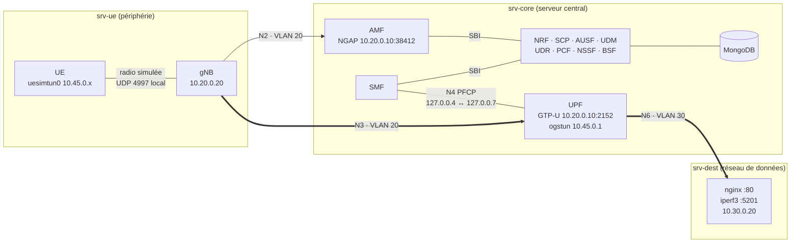

# Architecture distribuée et justification des choix (lot L1)

> Référent : **Lounes**. Ce document répond à l'objectif **O1 – Architecture distribuée justifiée** du cahier des charges.
> Valeurs d'adressage : [`plan-adressage.md`](plan-adressage.md) · Paramètres machine : [`parametres.yml`](parametres.yml) · Chemin d'un paquet et diagnostic : [`chemin-et-diagnostic.md`](chemin-et-diagnostic.md)

## 1. Rappel du besoin

Le client (une PME avec un atelier, un bâtiment logistique, un serveur central et des machines de périphérie) refuse le démonstrateur mono-poste pour trois raisons : tout est sur une seule machine, l'installation n'est pas reproductible, et il n'existe aucun moyen automatique de savoir où le réseau échoue.

L'architecture doit donc :

- répartir les fonctions selon leur rôle et leur emplacement (au moins 2 hôtes, **N2 et N3 traversant un vrai réseau**) ;
- placer un **serveur de réseau de données distinct au-delà de l'UPF** (N6) ;
- rester **reconstructible par automatisation** depuis des hôtes vierges ;
- permettre de **localiser la fonction défaillante** lors d'un incident.

## 2. Architecture retenue (option A) : « cœur centralisé, accès en périphérie, DN séparé »

| Hôte | Emplacement chez le client | Fonctions | Interfaces portées |
|------|---------------------------|-----------|--------------------|
| `srv-ctrl` | Poste d'exploitation | Automatisation, recette, scripts de mesure | Administration (VLAN 10) |
| `srv-ue` | Machine de périphérie (atelier) | gNB + UE simulés (UERANSIM) | N2, N3 (VLAN 20) |
| `srv-core` | Serveur central (salle informatique) | NRF, SCP, AMF, SMF, UPF, AUSF, UDM, UDR, PCF, NSSF, BSF, MongoDB, WebUI | N2, N3 (VLAN 20), N4 + SBI (local), N6 (VLAN 30) |
| `srv-dest` | Serveur applicatif du client | Serveur web nginx + serveur iperf3 | N6 (VLAN 30) |

Le schéma ASCII de référence (avec les VLAN et les adresses) est dans [`../schéma.txt`](../schéma.txt).

### Pourquoi ce découpage

1. **Invariants respectés directement** : N2 (SCTP) et N3 (GTP-U) traversent le VLAN 20 entre deux machines physiques ou virtuelles distinctes, et N6 traverse le VLAN 30 vers un hôte séparé. Aucune de ces interfaces ne passe par la boucle locale.
2. **Fidèle au contexte client** : le cœur est sur le serveur central, et l'accès radio sur une machine de périphérie proche de l'atelier.
3. **N4 et SBI restent locaux** : le plan de contrôle d'Open5GS (11 fonctions qui dialoguent en HTTP/2 via le SCP et le NRF) reste sur un seul hôte. Cela limite le nombre de points de défaillance réseau à ceux que le sujet impose d'étudier (N2/N3/N6).
4. **Segmentation par plan** : un VLAN par usage (administration / accès-cœur / données). Une capture sur un VLAN ne contient qu'un seul type de trafic, ce qui simplifie l'analyse de traces et permet d'injecter un incident sur une seule interface (`tc netem`, coupure de lien, règle de pare-feu).
5. **UE et gNB sur le même hôte** : le lien radio est simulé par UERANSIM (UDP local). Le séparer n'apporterait aucune interface 3GPP supplémentaire à faire traverser le réseau, et ajouterait un hôte à reconstruire.
6. **Un conteneur par fonction réseau** : chaque NF du cœur tourne dans son propre conteneur (`open5gs-amf`, `open5gs-smf`, `open5gs-upf`…). On peut ainsi arrêter, redémarrer, lire les journaux ou provoquer une panne sur **une seule fonction**, et la recette peut désigner précisément la fonction qui échoue (voir [`chemin-et-diagnostic.md`](chemin-et-diagnostic.md)).

## 3. Alternatives comparées

| Option | Description | Hôtes |
|--------|-------------|-------|
| **A (retenue)** | Cœur complet sur `srv-core`, gNB+UE sur `srv-ue`, DN sur `srv-dest` | 3 (+ contrôleur) |
| **B** | Plan de contrôle sur le serveur central, **UPF déplacé en périphérie** sur un hôte à part (CUPS, « UPF local ») : N4 traverse le réseau, N3 devient court | 4 (+ contrôleur) |
| **C** | Démonstrateur actuel : tout sur une seule machine (référence refusée par le client) | 1 |
| **D** | Deux hôtes seulement : gNB+UE d'un côté, cœur + serveur DN (conteneur) de l'autre | 2 |

### Critères et évaluation

Notation : ++ très favorable · + favorable · − défavorable · −− rédhibitoire

| Critère | Poids | A | B | C | D |
|---------|:-----:|:-:|:-:|:-:|:-:|
| Respect des invariants (N2/N3 sur réseau réel, DN distinct au-delà de l'UPF) | éliminatoire | ✅ | ✅ | ❌ | ❌ (DN pas sur un hôte distinct) |
| Fidélité au contexte client (central + périphérie) | 2 | + | ++ | −− | − |
| Complexité de l'automatisation (nombre d'hôtes et de configurations croisées) | 3 | + | − | ++ | ++ |
| Durée de reconstruction attendue (E1) | 2 | + | − | ++ | + |
| Diagnosticabilité (une interface = un VLAN, une NF = un conteneur) | 3 | ++ | + | − | + |
| Interfaces exposées à un phénomène de distribution (O5) | 2 | N2, N3, N6 | N2, N3, **N4**, N6 | aucune | N2, N3 |
| Ressources nécessaires (VM, RAM) | 1 | + | − | ++ | ++ |
| Risque technique pour le J2 | 3 | + | −− | ++ | + |

**Décision** : l'option **A**. Les options C et D sont éliminées par les invariants. L'option B est plus proche d'un déploiement industriel (UPF au plus près des usages, faible latence N3), mais elle ajoute un hôte et fait traverser le réseau à **N4/PFCP**. Il faut alors gérer l'association PFCP à distance (adresse `pfcp.server` de l'UPF, `upf.pfcp.client` côté SMF), un quatrième hôte à reconstruire, et un risque supplémentaire avant le J2. Elle est conservée comme **extension facultative** (« placement de l'UPF sur un troisième hôte », section 15 du cahier des charges) une fois les exigences obligatoires atteintes. Le plan d'adressage la prévoit déjà (voir `plan-adressage.md`, § 6).

## 4. Choix techniques et justifications

| Choix | Décision | Justification | Alternative écartée |
|-------|----------|---------------|---------------------|
| Mode d'installation | Conteneurs Docker (images figées dans `manifest.yml`) | Reconstruction identique depuis un hôte vierge. Les images peuvent être pré-chargées dans un cache local (`docker save`/`docker load`), ce qui respecte la règle « aucun téléchargement pendant la soutenance ». Un conteneur par NF facilite le diagnostic. | Paquets `.deb` (dépendent de dépôts en ligne, rollback plus difficile) ; compilation depuis les sources (trop lente pour E1) |
| Réseau Docker | `network_mode: host` | Le SCTP (N2) et le GTP-U (N3) doivent sortir **directement** par `eth1` avec les adresses du plan. Le NAT et la publication de ports de Docker gèrent mal le SCTP et masqueraient les vraies adresses dans les captures. Le mode host garde aussi les adresses SBI par défaut d'Open5GS (127.0.0.x). | Réseau bridge/macvlan (NAT SCTP, adresses à gérer en double) |
| Cœur | Open5GS 2.7.7 (`gradiant/open5gs:2.7.7`) | Imposé par le sujet. 2.7.7 est la version utilisée et figée dans le manifeste. Des CVE de déni de service sont publiées jusqu'à 2.7.7. Elles sont acceptables ici car le réseau de test est isolé, mais il faut les citer dans le rapport. | Version « latest » (non reproductible) |
| RAN | UERANSIM 3.2.6 (`gradiant/ueransim:3.2.6`) | Imposé par le sujet. Dernière version stable de la branche 3.2, compatible avec Open5GS 2.7.x. | — |
| Base d'abonnés | MongoDB 6.0.15 | Version supportée par Open5GS 2.7. Volume nommé `mongo_data` pour la persistance. | — |
| Segmentation | 3 VLAN (10 admin, 20 accès-cœur, 30 N6) | Isole les plans, simplifie les captures et l'injection d'incidents ciblés. | Un seul réseau plat (captures mélangées, incident impossible à cibler) |
| Sortie vers le DN | **Routage sans NAT** (route `10.45.0.0/16 via 10.30.0.10` sur srv-dest) | Le serveur voit les vraies adresses UE, ce qui rend les mesures iperf3 et les captures attribuables à chaque UE. | NAT masquerade sur srv-core (plus simple, mais masque l'UE) |
| Secrets | Clés K/OPc fournies au déploiement (variables d'environnement / ansible-vault), jamais dans Git | Exigence O2 « sans secret dans le dépôt » | Clés UERANSIM par défaut commitées |
| MTU | MTU de `uesimtun0` à 1400 | GTP-U ajoute 44 octets (IP+UDP+GTP+extension). 1400 laisse de la marge sous 1456 et évite la fragmentation sur N3. Paramètre à mettre en avant pour O5 (phénomène lié à la distribution). | 1500 par défaut (fragmentation N3) |

## 5. Risques liés à l'architecture

| # | Risque | Probabilité | Impact | Parade |
|---|--------|:-----------:|:------:|--------|
| R1 | Module noyau SCTP absent ou bloqué sur srv-core / srv-ue → N2 impossible | Moyenne | Bloquant | `modprobe sctp` dans l'automatisation, étape 6 de `diag-chemin.sh` |
| R2 | `ip_forward` désactivé ou route retour absente sur srv-dest → l'UE s'attache mais pas de trafic | Forte | Bloquant | Activer `net.ipv4.ip_forward=1` (srv-core) + route `10.45.0.0/16` (srv-dest), étapes 7 et 11 de `diag-chemin.sh` |
| R3 | Paramètres PLMN/TAC/slice différents entre gNB, AMF et UE → NG Setup ou enregistrement refusé | Forte | Bloquant | Une seule source (`parametres.yml`) pour générer toutes les configurations |
| R4 | Fragmentation GTP-U (MTU) → pertes et baisse de débit | Moyenne | Dégradé | MTU UE 1400, mesure avant/après (piste O5) |
| R5 | Pare-feu de l'hôte filtrant SCTP 38412 ou UDP 2152 | Moyenne | Bloquant | Règles explicites dans l'automatisation, contrôle de ports |
| R6 | Version d'image non figée (`iperf3:latest`) → reconstruction non reproductible | Certaine | Moyen | Figer un tag ou un digest (voir § 6) |

## 6. Points à corriger signalés aux autres lots

- **L3 (Ethan)** : `ue-gnb/docker-compose.yml` se termine par `volumes:` vide pour le service `ue`, il manque `- ./config:/etc/ueransim`. Les dossiers `ue-gnb/config/` (gnb.yaml, ue.yaml) et `dn/html/` n'existent pas encore.
- **L2 (Alexis)** : `core/docker-compose.yml` monte `./config` mais le dossier `core/config/` (amf.yaml, smf.yaml, upf.yaml, nrf.yaml…) n'est pas encore dans le dépôt. Les adresses à y mettre sont dans `parametres.yml`.
- **Manifeste** : `networkstatic/iperf3:latest` n'est pas une version figée (exigence « versions figées et justifiées »). Il faut le remplacer par un digest `@sha256:…` relevé au moment du choix.
- **L4 (Mohamed)** : le script `architecture/diag/diag-chemin.sh` donne, pour chaque étape du chemin, la fonction mise en cause. Il peut servir de base ou de complément à la recette automatisée.
