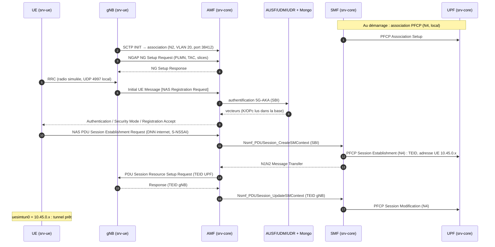

# Chemin d'accès, chemin d'un paquet et diagnostic par fonction (lot L1)

> Référent : **Lounes**. Ce document décrit le chemin complet d'un accès 5G (procédures puis paquet de données) dans notre architecture distribuée. Pour chaque étape, il indique **quelle fonction (quel conteneur)** est en jeu, **quelle preuve** relever et **quelles causes** chercher quand elle échoue.
> Outil associé : [`diag/diag-chemin.sh`](diag/diag-chemin.sh) (exécutable depuis `srv-ctrl`).

## 1. Principe : séparer les conteneurs pour savoir quelle fonction échoue

Dans le démonstrateur mono-poste refusé par le client, une panne se manifeste par « l'UE n'a pas Internet », sans indication de l'endroit où elle se produit. Dans notre architecture :

- **chaque fonction réseau tourne dans son propre conteneur** (`open5gs-amf`, `open5gs-smf`, `open5gs-upf`, `open5gs-nrf`… sur srv-core ; `ueransim-gnb`, `ueransim-ue` sur srv-ue ; `dn-nginx`, `dn-iperf3` sur srv-dest) ;
- chaque conteneur a ses propres journaux (`docker logs <conteneur>`), son état (`docker inspect`) et son compteur de redémarrages ;
- chaque interface 3GPP qui traverse le réseau est sur **son VLAN**, ce qui permet de la capturer et d'y provoquer une panne isolément.

On peut donc tester le chemin **dans l'ordre où il se construit** et s'arrêter à la première étape qui échoue : la fonction à mettre en cause est celle de cette étape. C'est ce que fait `diag-chemin.sh`. Son code de sortie est le numéro de la première étape en échec, ce qui permet à la recette (lot L4) de le réutiliser directement.

## 2. Chemin des procédures (plan de contrôle)



## 3. Chemin d'un paquet (plan utilisateur)

Exemple : l'UE fait `ping -I uesimtun0 10.30.0.20`.

| # | Où | Ce qui arrive au paquet | Adresses visibles | Point de capture |
|---|----|------------------------|-------------------|------------------|
| 1 | srv-ue, `uesimtun0` | Le paquet IP de l'UE part dans l'interface TUN créée par UERANSIM | 10.45.0.2 → 10.30.0.20 (ICMP) | `tcpdump -i uesimtun0` |
| 2 | srv-ue, UE → gNB | Transport sur le lien radio simulé | UDP 127.0.0.1:4997 (local) | `tcpdump -i lo udp port 4997` |
| 3 | srv-ue, gNB | **Encapsulation GTP-U** avec le TEID donné par l'UPF | externe 10.20.0.20 → 10.20.0.10 UDP 2152 ; interne 10.45.0.2 → 10.30.0.20 | — |
| 4 | **VLAN 20 (N3)** | Le paquet encapsulé traverse le réseau réel | +44 octets (IP 20 + UDP 8 + GTP 8 + ext. 8) | `tcpdump -i eth1 udp port 2152` sur srv-core, filtre Wireshark `gtp` |
| 5 | srv-core, UPF | Recherche de la session par TEID (règles PDR/FAR reçues du SMF par PFCP), **décapsulation**, remise sur `ogstun` | 10.45.0.2 → 10.30.0.20 | `tcpdump -i ogstun` |
| 6 | srv-core, noyau | **Routage** (`ip_forward=1`, sans NAT) de `ogstun` vers `eth2` | 10.45.0.2 → 10.30.0.20 | — |
| 7 | **VLAN 30 (N6)** | Paquet IP « nu » vers le DN | 10.45.0.2 → 10.30.0.20 | `tcpdump -i eth2` (srv-core) ou `-i eth1` (srv-dest) |
| 8 | srv-dest | nginx / iperf3 / noyau répondent | 10.30.0.20 → 10.45.0.2 | — |
| 9 | srv-dest → srv-core | **Route retour** `10.45.0.0/16 via 10.30.0.10` | — | `ip route get 10.45.0.2` |
| 10 | srv-core, UPF | Le paquet entre par `ogstun`, l'UPF le classe (adresse UE) et l'**encapsule** avec le TEID du gNB | 10.20.0.10 → 10.20.0.20 UDP 2152 | `eth1` |
| 11 | srv-ue | Le gNB décapsule et transmet à l'UE, la réponse apparaît sur `uesimtun0` | 10.30.0.20 → 10.45.0.2 | `uesimtun0` |

**Conséquence de la distribution** : aux étapes 4 et 7, le paquet traverse un vrai réseau. Il est donc exposé au MTU (fragmentation de GTP-U si le paquet interne dépasse 1456 octets), au délai, aux pertes et au filtrage. C'est là qu'il faut chercher le phénomène étudié en O5 (lot L5).

## 4. Diagnostic étape par étape (correspondance avec `diag-chemin.sh`)

Méthode R5.03 : **étape → preuve → cause → correction → vérification**.

| Étape | Fonction / conteneur | Ce qui est vérifié | Preuve à relever en cas d'échec | Causes probables | Correction |
|:-----:|----------------------|--------------------|--------------------------------|------------------|-----------|
| 1 | hôtes | SSH sur le VLAN 10 | `ssh -v` | Hôte éteint, VLAN 10, clé SSH | Rallumer, corriger le réseau d'administration |
| 2 | réseau (VLAN 20/30) | ping 10.20.0.20→10.20.0.10 et 10.30.0.10→10.30.0.20 | `ip -br a`, `ip neigh` (ARP incomplet ?) | Mauvais VLAN/adresse sur eth1/eth2, interface down | Corriger l'adressage (voir `plan-adressage.md`) |
| 3 | chaque NF du cœur | Conteneur `open5gs-<nf>` démarré, nombre de redémarrages | `docker logs open5gs-<nf>` (souvent « Failed to parse configuration ») | YAML invalide, fichier de configuration absent, port déjà pris | Corriger `core/config/<nf>.yaml`, `docker compose up -d <nf>` |
| 4 | MongoDB / UDR | Base joignable, au moins un abonné | `mongosh open5gs --eval 'db.subscribers.find()'` | Abonné non provisionné, base vide après reconstruction | Relancer le provisionnement des abonnés (lot L2) |
| 5 | NRF, SCP et NF SBI | Écoute TCP 7777 sur 127.0.0.x, enregistrements au NRF | `ss -ltnp`, `docker logs open5gs-nrf \| grep registered`, capture `http2` sur `lo` | NF arrêtée, adresse SBI modifiée, NRF injoignable | Restaurer l'adresse par défaut, redémarrer la NF |
| 6 | **AMF** (N2) | Écoute SCTP 10.20.0.10:38412 | `ss -Sln`, `lsmod \| grep sctp` | Module sctp absent, `ngap.server` faux | `modprobe sctp`, corriger `amf.yaml` |
| 7 | **UPF / SMF** (N3, N4) | Écoute GTP-U 10.20.0.10:2152, association PFCP, `ogstun`, `ip_forward` | `docker logs open5gs-smf \| grep PFCP`, `ip a show ogstun`, `sysctl net.ipv4.ip_forward` | `gtpu.server` faux, `/dev/net/tun` ou `NET_ADMIN` manquant, `ip_forward=0` | Corriger `upf.yaml`/compose, `sysctl -w net.ipv4.ip_forward=1` |
| 8 | **gNB** ↔ AMF (N2 sur le réseau) | Association SCTP puis « NG Setup procedure is successful » | `docker logs ueransim-gnb`, capture sur srv-core eth1 : filtre `ngap` (NGSetupFailure + cause) | Pare-feu SCTP, PLMN/TAC/slice différents entre `gnb.yaml` et `amf.yaml` | Aligner sur `parametres.yml`, ouvrir SCTP 38412 |
| 9 | **UE** ↔ AMF/AUSF/UDM/UDR | « Initial Registration is successful » | `docker logs ueransim-ue`, `docker logs open5gs-amf`, filtre `nas-5gs` (Registration Reject + cause 5GMM) | IMSI absent de la base, K/OPc faux (échec MAC), slice non autorisée | Corriger l'abonné ou les secrets injectés |
| 10 | **SMF** + UPF (N4) + gNB (N3) | « PDU Session establishment is successful », `uesimtun0` a une adresse | `docker logs open5gs-smf`, filtre `pfcp` sur `lo` | DNN ou S-NSSAI inconnus du SMF, PFCP en échec, pool d'adresses épuisé | Aligner DNN/slice, redémarrer SMF/UPF |
| 11 | **DN** (srv-dest) | nginx/iperf3 démarrés, route retour vers 10.45.0.0/16 | `ip route get 10.45.0.2` | Route retour absente, services arrêtés | `ip route add 10.45.0.0/16 via 10.30.0.10` (automatisation L3) |
| 12 | **plan utilisateur** de bout en bout | ping + HTTP via `uesimtun0` | Captures simultanées `uesimtun0` / `eth1` (gtp) / `ogstun` / `eth2` : la dernière capture où le paquet apparaît désigne le tronçon fautif | UDP 2152 filtré, `ip_forward`, route retour, MTU/fragmentation | Selon le tronçon identifié |

### Lecture rapide

- **Étapes 3 à 7 en échec, 1 et 2 OK** : panne **locale au cœur** (configuration ou conteneur).
- **Étape 8 en échec seule** : panne sur **N2** (réseau entre srv-ue et srv-core, ou paramètres d'identité du réseau).
- **Étape 9 en échec** : panne d'**abonnement / authentification** (UDM/UDR/AUSF/base, ou secrets).
- **Étapes 1 à 11 OK, 12 en échec** : panne du **plan utilisateur** (N3 filtré, routage, MTU). Il faut alors localiser le tronçon avec les captures du § 3.

## 5. Incidents provoqués possibles (pour E4) et étape attendue

Chaque incident vise **une seule fonction ou une seule interface**, ce qui n'est possible que parce que les fonctions sont séparées. L'incident retenu pour E4 doit être différent du phénomène étudié en O5.

| Incident provoqué | Commande | Première étape en échec attendue |
|-------------------|----------|:--------------------------------:|
| Coupure du lien N2/N3 | `ip link set eth1 down` sur srv-ue | 2 |
| Arrêt de l'AMF | `docker stop open5gs-amf` | 3 (amf) |
| Arrêt du SMF | `docker stop open5gs-smf` | 3 (smf) |
| Arrêt de l'UPF | `docker stop open5gs-upf` | 3 (upf) |
| Suppression de l'abonné | suppression dans MongoDB | 4 |
| Transfert IP désactivé | `sysctl -w net.ipv4.ip_forward=0` sur srv-core | 7 |
| TAC différent dans `gnb.yaml` | modifier `tac` puis redémarrer le gNB | 8 |
| SCTP filtré | `nft add rule inet filter input sctp dport 38412 drop` sur srv-core | 8 |
| Clé K erronée côté UE | modifier `key` dans `ue.yaml` | 9 |
| Route retour supprimée | `ip route del 10.45.0.0/16` sur srv-dest | 11 |
| GTP-U filtré | `nft add rule inet filter input udp dport 2152 drop` sur srv-core | 12 |

Vérification après correction : relancer `diag-chemin.sh`, qui doit retourner le code 0.

## 6. Utilisation du script

```bash
# depuis srv-ctrl (clé SSH déployée sur les 3 hôtes, sudo sans mot de passe pour docker)
bash architecture/diag/diag-chemin.sh | tee resultats/diag-$(date +%Y%m%d-%H%M%S).log
echo "première étape en échec : ${PIPESTATUS[0]}"

# sur un seul hôte (tests)
CORE_HOST=local UE_HOST=local DN_HOST=local bash architecture/diag/diag-chemin.sh
```

Le script ne modifie rien sur les hôtes : il lit seulement les états, les journaux et les sockets, et envoie un ping et une requête HTTP. Il a été validé hors maquette avec des commandes simulées. Le cas nominal renvoie 0 ; avec l'AMF arrêtée, il renvoie 3 (amf). Il **reste à valider sur la vraie maquette** au J2 (formulation exacte des journaux des images `gradiant/*`).
